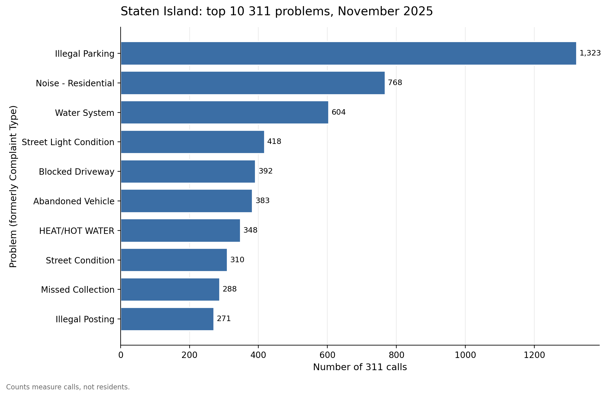
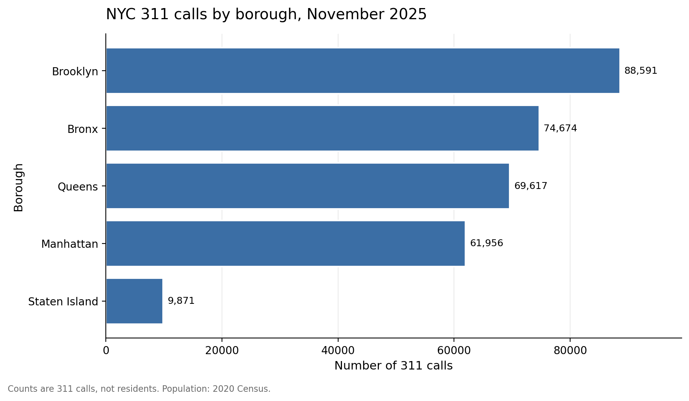
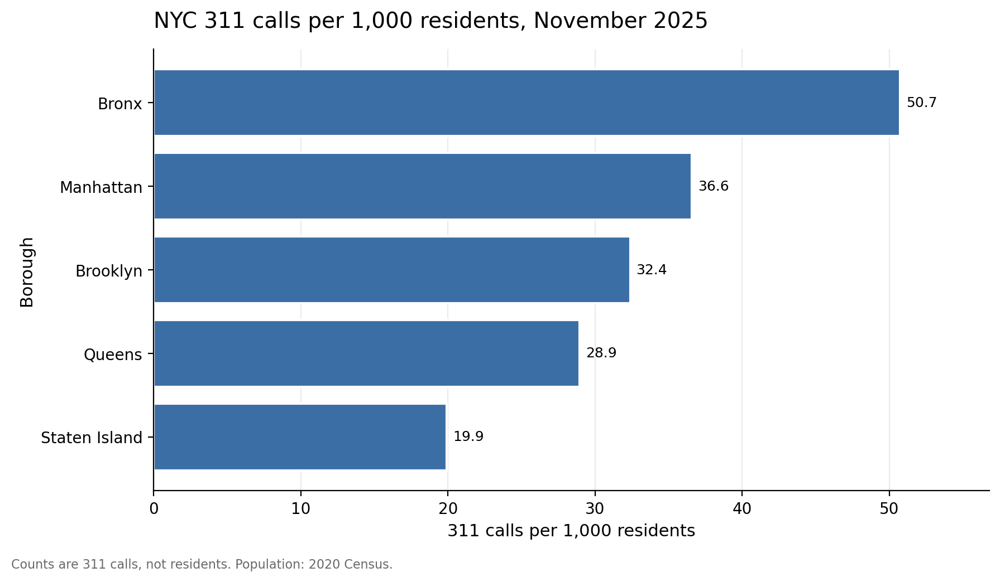
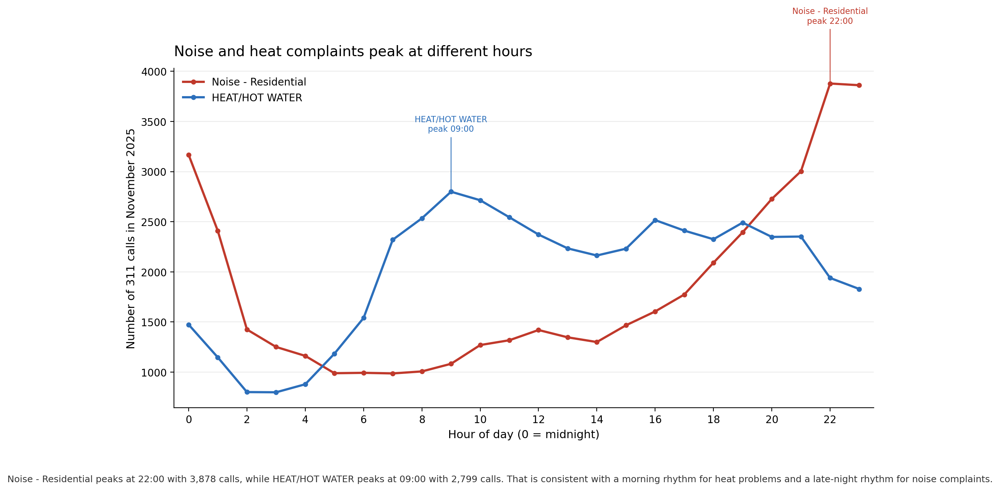
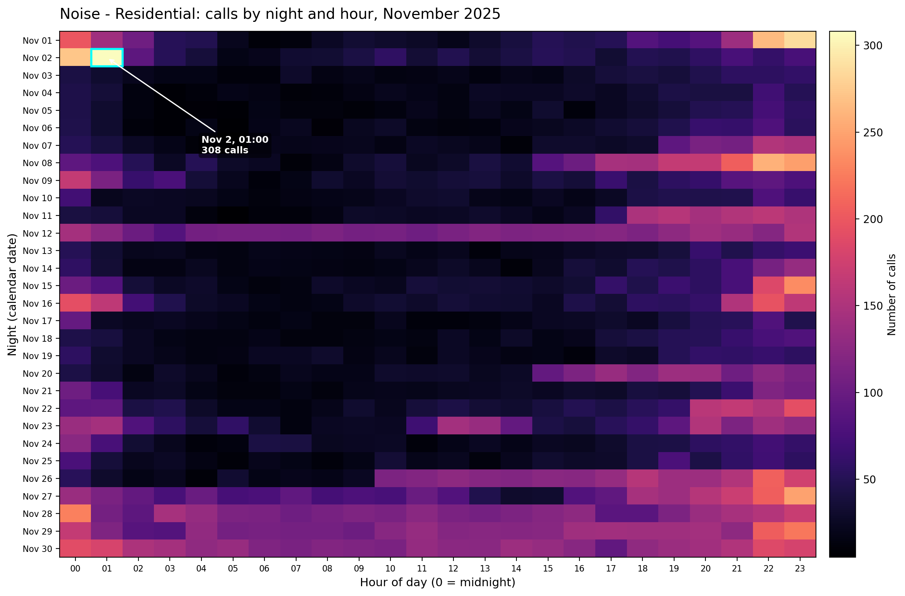

testing

## Task 1

| Question | Answer |
|---|---|
| How many rows and columns? | **304,905 rows × 44 columns** |
| How many distinct values does `Problem (formerly Complaint Type)` have? | **174** |
| Earliest `Created Date` | **2025-11-01 00:00:04** |
| Latest `Created Date` | **2025-11-30 23:59:52** |
| How many rows have no `Closed Date`? | **4,136** |

Source: `nyc-311-2025-november.csv.gz`. Each answer was computed with pandas and then independently verified by streaming the gzipped CSV with Python's `csv` module; see `task1.py`.

### Verification

- **Rows:** `zcat nyc-311-2025-november.csv.gz | wc -l` = 304,906 lines = 1 header + 304,905 rows. The header has 44 fields.
- **Distinct Problem:** pandas `nunique()` = 174; a set built from the raw CSV = 174. No blank values.
- **Created Date:** parsed with `%m/%d/%Y %I:%M:%S %p`; all 304,905 values parsed, and an independent `datetime.strptime` pass gives the same earliest and latest.
- **No Closed Date:** pandas `isna()` = 4,136; rows whose raw `Closed Date` field is `""` = 4,136.

### Status of rows with no `Closed Date`

| Status | Rows |
|---|---|
| In Progress | 3,402 |
| Open | 300 |
| Pending | 199 |
| Assigned | 168 |
| Started | 65 |
| Closed | 2 |

Note: the 2 rows marked `Status = Closed` with no `Closed Date` (Unique Keys `66937975` and `66784599`) are a quirk of the source data, not a parsing error.

## Task 2

Borough: **Staten Island**. Comparison borough: **Queens**. Script: `task2.py`. Counts below measure 311 calls, not residents.

| Question | Answer |
|---|---|
| How many 311 calls did Staten Island record? | **9,871** |
| What are its top 5 complaints? | Table below |
| Top-10 chart | **`fig-borough-staten-island.png`** |
| Does one address dominate its top complaint? | **No** — the busiest address, 555 Johnston Terrace, has 17 of 1,323 Illegal Parking calls (1.3%) |
| Second borough | **Queens** — 69,617 calls, about 7.1 times Staten Island; comparison below |

### Staten Island: top 5 complaints

| # | Problem (formerly Complaint Type) | Calls | Share of borough |
|---|---|---:|---:|
| 1 | Illegal Parking | 1,323 | 13.4% |
| 2 | Noise - Residential | 768 | 7.8% |
| 3 | Water System | 604 | 6.1% |
| 4 | Street Light Condition | 418 | 4.2% |
| 5 | Blocked Driveway | 392 | 4.0% |

Shares use all 9,871 Staten Island calls as the denominator.

### Top-10 chart

The horizontal bar chart labels the x-axis “Number of 311 calls” and the y-axis “Problem (formerly Complaint Type)”; the caption notes that counts are calls, not residents.

### Address trap

No single address dominates Staten Island’s top complaint: the busiest address for Illegal Parking is 555 Johnston Terrace with 17 calls, 1.3% of that category’s 1,323 calls. The top two addresses together account for 32 calls (2.4%), so the complaint is spread across the borough rather than driven by one location.

Queens is more concentrated: 5-47 50 Avenue has 465 Illegal Parking calls (3.1%) and 34-16 Astoria Boulevard South has 370; together the top two addresses are 5.6% of the category. That is still not a single-address monopoly, but repeated reports about a few locations shape the borough total.

### Queens compared with Staten Island

> Queens recorded 69,617 calls in November 2025 — about 7.1 times Staten Island’s 9,871 — and its top problem is also Illegal Parking, but it accounts for 21.2% of Queens calls versus 13.4% on Staten Island. The rest of Queens’ top five leans toward housing and neighborhood noise — HEAT/HOT WATER (9.9%), Blocked Driveway (9.5%), Noise - Residential (8.4%), Noise - Street/Sidewalk (4.7%) — whereas Staten Island’s top five also includes Water System and Street Light Condition. A plausible hypothesis is that Queens’ denser, more mixed housing stock and heavier curbside demand generate more parking, heat, and noise calls per resident, while Staten Island’s lower density and different housing and infrastructure mix give water and streetlight problems a larger share of its much smaller call base. Within Queens’ top category, two addresses — 5-47 50 Avenue (465 calls) and 34-16 Astoria Boulevard South (370 calls) — account for 5.6% of the calls, so part of that total reflects repeated reports about a few locations. None of this proves the why: the dataset counts calls, not people, and reporting habits can differ from borough to borough.

## Task 3

Raw counts flatter large boroughs. This section normalizes each borough’s November 311 calls by its 2020 Census population. Script: `task3.py`. The Census API key is read from the `CENSUS_API_KEY` environment variable and is not stored in this repository.

| Question | Answer |
|---|---|
| Five-borough population (2020 Census) | **8,804,190** |
| Which borough had the most raw calls? | **Brooklyn** — 88,591 |
| Which borough had the highest rate per 1,000 residents? | **Bronx** — 50.7 |
| Did ranks change? | **Yes** — Brooklyn 1st → 3rd, Bronx 2nd → 1st, Manhattan 4th → 2nd, Queens 3rd → 4th; Staten Island stayed 5th |
| Rows set aside | **196** `Unspecified` rows (0.06%) dropped — they have no population to normalize against |
| Charts | `fig-borough-raw.png`, `fig-borough-per1000.png` |

### Population and normalized rate

| Borough | Population | Calls | Calls per 1,000 | Raw rank | Rate rank |
|---|---:|---:|---:|---:|---:|
| Brooklyn | 2,736,074 | 88,591 | 32.4 | 1 | 3 |
| Bronx | 1,472,654 | 74,674 | 50.7 | 2 | 1 |
| Queens | 2,405,464 | 69,617 | 28.9 | 3 | 4 |
| Manhattan | 1,694,251 | 61,956 | 36.6 | 4 | 2 |
| Staten Island | 495,747 | 9,871 | 19.9 | 5 | 5 |

Complaint counts are joined to the population table on `Borough`; 304,709 of 304,905 rows remain after dropping `Unspecified`.

### Charts

**Raw counts**

**Calls per 1,000 residents**

Both charts label the x-axis in human-readable terms (“Number of 311 calls” and “311 calls per 1,000 residents”) and use “Borough” on the y-axis.

### Verification

Plain-calculator check (Bronx): 74,674 calls ÷ 1,472,654 residents × 1,000 = **50.71** calls per 1,000 residents. The table shows 50.7 after rounding; the same calculation is a comment next to `Per1000` in `task3.py`.

Population check: 1,472,654 + 2,736,074 + 1,694,251 + 2,405,464 + 495,747 = **8,804,190**, roughly 8.8 million as expected.

### 3c write-up

> Yes: Brooklyn falls from first in raw calls (88,591) to third per 1,000 residents (32.4), while the Bronx rises from second to first (50.7) and Manhattan jumps from fourth to second (36.6); Queens slips from third to fourth (28.9), and Staten Island stays fifth (19.9). Brooklyn and Queens are large, relatively lower-density outer boroughs with more low-rise, owner-occupied neighborhoods, so their big raw totals mostly track population size rather than a higher rate of calling 311. Manhattan’s high rate is plausibly explained by dense rental housing, older buildings, and a huge daytime population of workers and visitors who can call 311 but are not counted in the resident denominator. The Bronx’s leading rate is consistent with dense, older housing stock and more housing-condition complaints, though the data cannot tell us whether that reflects greater need, greater willingness to report, or both. Even the per-1,000 measure is only a rough correction, because the denominator counts residents while the numerator counts calls that anyone can make.

## Task 4

Two problem types chosen for their different expected rhythms: **Noise - Residential** and **HEAT/HOT WATER**. Script: `task4.py`. Counts are 311 calls, not residents.

| Question | Answer |
|---|---|
| Noise - Residential peak | **22:00** — 3,878 calls |
| HEAT/HOT WATER peak | **09:00** — 2,799 calls |
| Does the claim survive a borough split? | **Yes** — in Brooklyn, noise still peaks at **22:00** (910 calls) and heat at **09:00** (845 calls) |
| `Created Date` dtype | `object` before parsing → **`datetime64[ns]`** after; **0** parse failures |
| Peak matches `value_counts()` / table? | **Yes** — noise `value_counts` 22, table 22; heat `value_counts` 9, table 9 |
| Charts | `fig-hours.png`, `fig-nights.png` |

### Claim under the chart

> Noise - Residential peaks at 22:00 with 3,878 calls, while HEAT/HOT WATER peaks at 09:00 with 2,799 calls. That is consistent with a morning rhythm for heat problems and a late-night rhythm for noise complaints.

### Hourly chart

The chart plots lines, not bars, with “Hour of day (0 = midnight)” on the x-axis and “Number of 311 calls in November 2025” on the y-axis.

### Night-by-night heat map

The heat map follows the late-night curve, **Noise - Residential**. It is a 30-row × 24-column day-by-hour table (one row per calendar date, hours 00–23) containing all 43,928 noise calls.

The standout cell is **2025-11-02 01:00 — 308 calls**, about **7.7 times** the median 01:00 count of 40 on other nights. Nov 12 is also visibly elevated all day: 2,817 noise calls, of which **2,139 (75.9%)** came from one address, 655 East 230 Street.

### Verification

- **Date parsing:** `Created Date` is `object` before parsing and `datetime64[ns]` after; all **304,905** values parsed with zero NaT, and every hour is in 0–23.
- **Peak hours:** the plotted peaks match both `value_counts()` and the groupby/table output for the same filtered data — noise 22, heat 9.
- **Night table:** shape is **30 × 24**, and its cells sum to **43,928**, exactly the number of Noise - Residential rows.
- **Bad rows / duplicates:** zero duplicate `Unique Key` values and zero fully duplicated rows in the full dataset.
- **Burst check for the 01:00 cell:** its 308 calls span **five boroughs and 248 addresses**, with the busiest address contributing only 10 calls (3.2%), so the spike is not one address or one copied record. Nov 12’s 2,139-call cluster at 655 East 230 Street is a separate, real one-address burst.

### Five-sentence analysis

> No: most nights share a late-night peak, but Nov 12 is elevated all day and Nov 2 has a sharp 1 a.m. spike. The largest single cell is 2025-11-02 at 01:00, with 308 Noise - Residential calls — about 7.7 times the median 01:00 count on other nights (40). I think that 1 a.m. spike is the end of daylight saving time at 2:00 a.m. that morning, which made 1:00–1:59 occur twice and collapsed two clock hours into one timestamp bucket, probably amplified by Saturday-night and Halloween-weekend reporting. Check one ruled out bad rows and duplicated records: all 304,905 Created Date values parsed to datetime64[ns] with zero NaT, zero duplicate Unique Keys, and zero fully duplicated rows. Check two ruled out a localized burst behind that cell: its 308 calls span five boroughs and 248 addresses, with the busiest address contributing only 10 calls (3.2%); Nov 12’s separate 2,817-call cluster at 655 East 230 Street (2,139 calls) is a real one-address burst, not the cause of the 1 a.m. spike.
