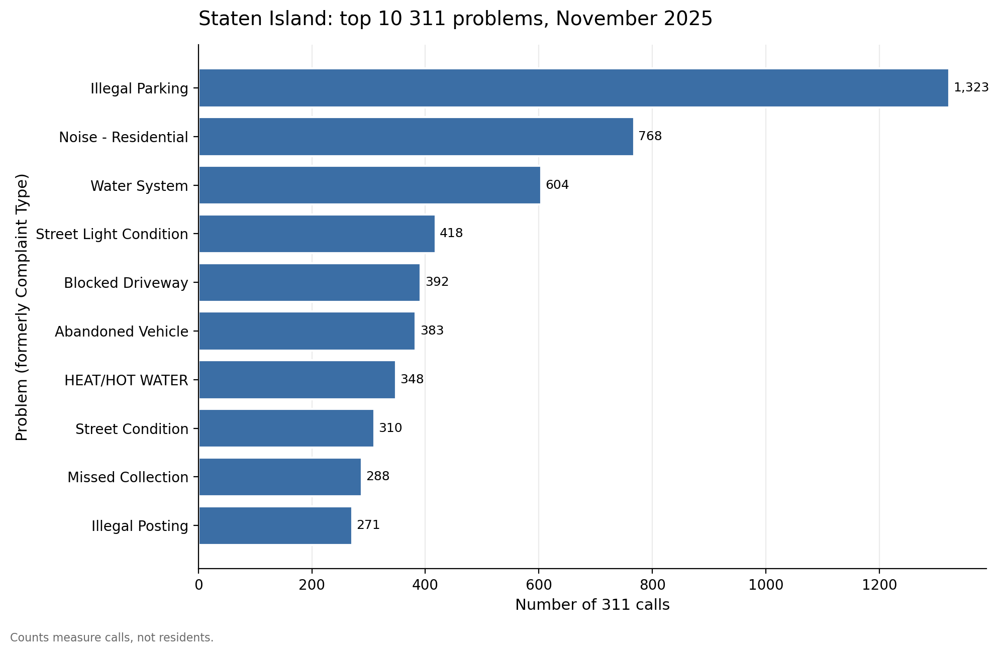
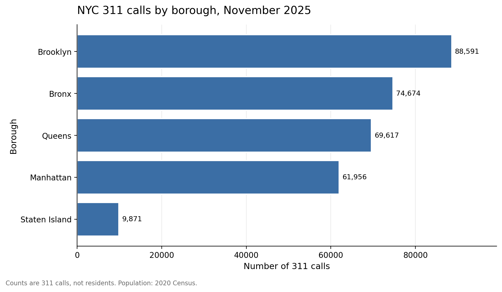
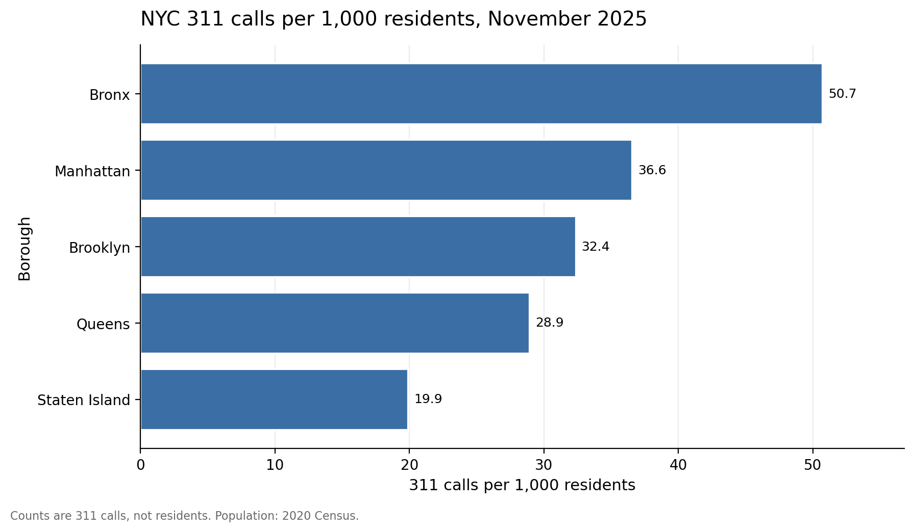
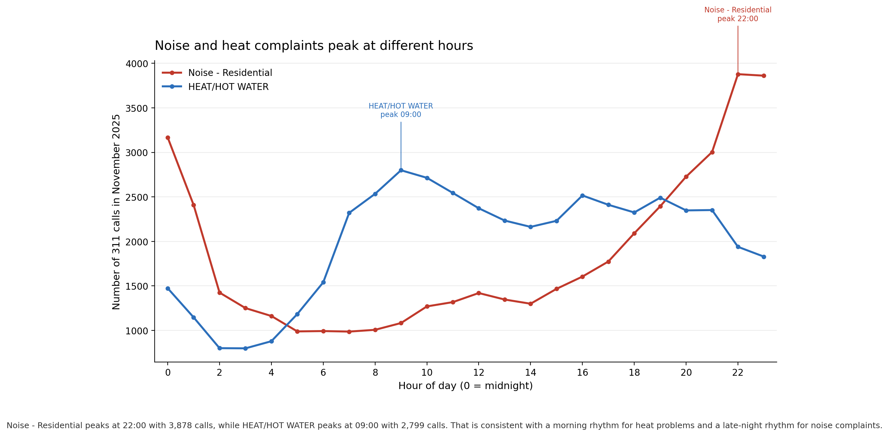
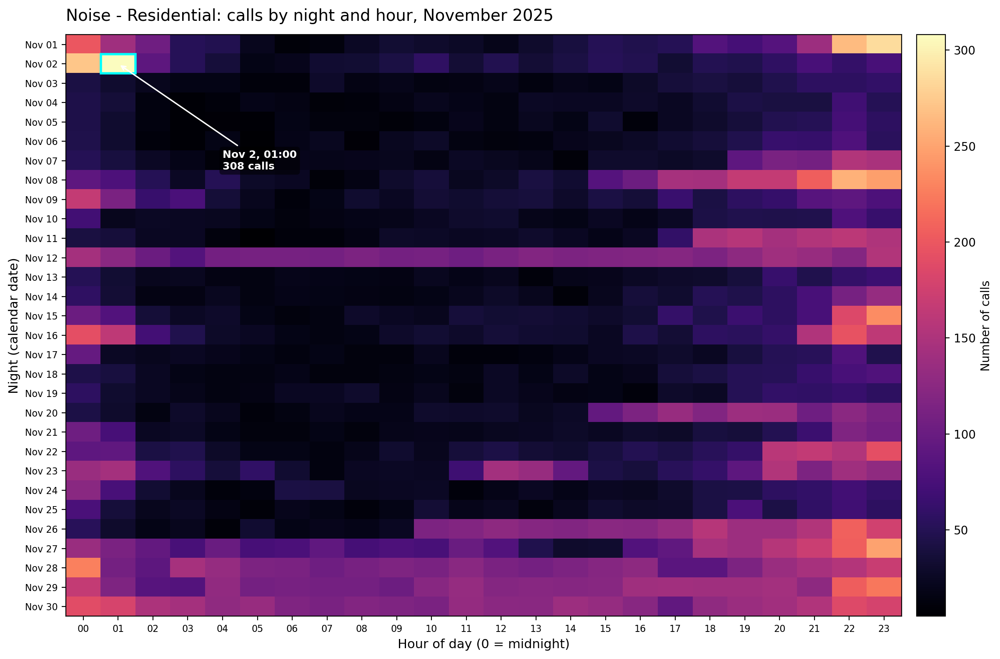
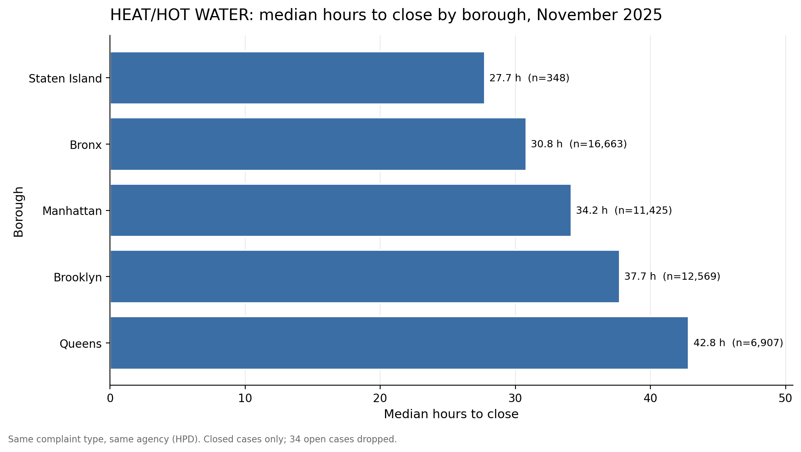

# NYC 311, November 2025 — Lab 11 Report

This report covers Tasks 1–7 on the November 2025 NYC 311 export. The raw file is
`nyc-311-2025-november.csv.gz` — **304,905 rows × 44 columns**. It is not tracked:
at roughly 39 MB it is far too large for the repository, and `.gitignore` excludes
`*.csv`, `*.csv.gz`, and `*.zip`.

Every headline number has a second route behind it. The task scripts keep their
own cross-checks in comments (for example `# Plain-calculator check (Bronx)` in
`task3.py` and `# Cross-check (Queens)` in `task6.py`), and
[`verify_report.py`](verify_report.py) re-derives every number in this report from
the gzipped CSV using only `csv`, `gzip`, `Counter`, `statistics`, and plain
arithmetic. It ends with **`All second-method checks passed.`**

## Files and how to run

| File | Purpose |
|---|---|
| [`task1.py`](task1.py) | Shape, distinct complaint types, date range, open cases — pandas plus a streaming `csv` check |
| [`task2.py`](task2.py) | Staten Island profile, Queens comparison, address-concentration check |
| [`task3.py`](task3.py) | 2020 Census population join and calls per 1,000 residents |
| [`task4.py`](task4.py) | Hourly rhythms, Brooklyn split, 30 × 24 night heat map, anomaly checks |
| [`task5.py`](task5.py) | Response-time medians by agency, longest case, DPR mean vs. median |
| [`task6.py`](task6.py) | HEAT/HOT WATER medians by borough — same job, different place |
| [`task7.py`](task7.py) | The 196 `Unspecified`-borough rows and three follow-up queries |
| [`verify_report.py`](verify_report.py) | Independent second pass over every headline number in this report |
| `.gitignore` | Keeps raw data, secrets, and Python caches out of Git |

```bash
python3 -m venv .venv
. .venv/bin/activate
pip install pandas matplotlib numpy

python3 task1.py
python3 task2.py

# Task 3 reads the Census key from the environment. Never write it to a tracked file.
export CENSUS_API_KEY="...your key..."
python3 task3.py

python3 task4.py
python3 task5.py
python3 task6.py
python3 task7.py

# Re-run every headline number through the independent raw-CSV route.
python3 verify_report.py
```

The only secret is the Census API key. `task3.py` reads it with
`os.environ.get("CENSUS_API_KEY", "").strip()`; it is never written into a source
file, the README, or this report.

## Task 1 — Reading the file

The first job is to know exactly what the file contains before trusting any later
percentage. The table below gives the five required answers; the Verify column
shows the independent route used for each one.

| Question | Answer | Verify |
|---|---|---|
| How many rows and columns? | **304,905 rows × 44 columns** | A streaming `csv.reader` pass counted 304,905 data rows and 44 header fields; pandas `df.shape` agrees. `zcat` followed by `wc -l` gives 304,906 lines = header + 304,905. |
| How many distinct `Problem (formerly Complaint Type)` values? | **174** | pandas `nunique()` = 174; a `set` built while streaming the raw CSV also has 174 values. |
| Earliest `Created Date` | **2025-11-01 00:00:04** | pandas `to_datetime` minimum and an independent `datetime.strptime` pass over every row agree. |
| Latest `Created Date` | **2025-11-30 23:59:52** | Same two routes; both give the same maximum. |
| Rows with no `Closed Date` | **4,136** | pandas `isna()` = 4,136; counting raw rows whose `Closed Date` field is the empty string also gives 4,136. |

### Status of the 4,136 rows with no `Closed Date`

| Status | Rows | Verify |
|---|---:|---|
| In Progress | 3,402 | Raw-CSV `Counter` over the same rows = 3,402 |
| Open | 300 | Raw-CSV `Counter` = 300 |
| Pending | 199 | Raw-CSV `Counter` = 199 |
| Assigned | 168 | Raw-CSV `Counter` = 168 |
| Started | 65 | Raw-CSV `Counter` = 65 |
| Closed | 2 | Raw-CSV `Counter` = 2 |

The two `Status = Closed` rows with no closure date (Unique Keys `66937975` and
`66784599`) are a quirk in the source, not a parsing failure: both the pandas path
and the raw-string path see the same two records.

The two-ways pattern in `task1.py`:

```python
rows, cols = df.shape

# Check: raw line count minus header, and header field count from csv module.
with gzip.open(PATH, "rt", encoding="utf-8", errors="replace", newline="") as f:
    reader = csv.reader(f)
    header = next(reader)
    csv_rows = sum(1 for _ in reader)
```

## Task 2 — One borough, then a comparison

**Borough:** Staten Island. **Comparison:** Queens. All counts are 311 calls, not
residents, and `task2.py` says so on the chart itself.

| Question | Answer | Verify |
|---|---|---|
| How many 311 calls did Staten Island record? | **9,871** | pandas `len()` = 9,871; raw-CSV `Counter` of `Borough` = 9,871. |
| What are its top five complaints? | Illegal Parking, Noise - Residential, Water System, Street Light Condition, Blocked Driveway | A raw-CSV `Counter` over Staten Island problem types reproduces the same five counts in the same order. |
| Does one address dominate its top complaint? | **No** — 555 Johnston Terrace has 17 of 1,323 Illegal Parking calls (1.3%) | Raw `Counter` on (Borough, Problem, Address) gives 17; 17 / 1,323 = 1.285%. |
| Second borough | **Queens** — 69,617 calls, about 7.1× Staten Island | Raw-CSV `Counter` = 69,617; 69,617 / 9,871 = 7.053. |
| Chart | `fig-borough-staten-island.png` | Re-opened the saved PNG and checked labels, ordering, and bar values. |

### Staten Island top five

| # | Problem | Calls | Share of borough | Verify |
|---:|---|---:|---:|---|
| 1 | Illegal Parking | 1,323 | 13.4% | Raw `Counter` = 1,323; 1,323 / 9,871 = 13.40% |
| 2 | Noise - Residential | 768 | 7.8% | Raw `Counter` = 768; 768 / 9,871 = 7.78% |
| 3 | Water System | 604 | 6.1% | Raw `Counter` = 604; 604 / 9,871 = 6.12% |
| 4 | Street Light Condition | 418 | 4.2% | Raw `Counter` = 418; 418 / 9,871 = 4.23% |
| 5 | Blocked Driveway | 392 | 4.0% | Raw `Counter` = 392; 392 / 9,871 = 3.97% |

### Address trap

| Borough | Top problem | Busiest address | Calls | Share of problem | Top two addresses | Verify |
|---|---|---|---:|---:|---|---|
| Staten Island | Illegal Parking | 555 Johnston Terrace | 17 | 1.3% | 32 calls (2.4%) | Raw `Counter`: 17 and 32; 17 / 1,323 = 1.285%, 32 / 1,323 = 2.419% |
| Queens | Illegal Parking | 5-47 50 Avenue | 465 | 3.1% | 835 calls (5.6%) | Raw `Counter`: 465 and 835; 465 / 14,779 = 3.146%, 835 / 14,779 = 5.650% |



The chart plots the top ten problem types as horizontal bars, labels the x-axis
“Number of 311 calls,” and uses “Problem (formerly Complaint Type)” on the y-axis.

### Staten Island compared with Queens

> Queens recorded 69,617 calls in November 2025 — about 7.1 times Staten Island’s
> 9,871 — and its top problem is also Illegal Parking, but it accounts for 21.2% of
> Queens calls versus 13.4% on Staten Island. The rest of Queens’ top five leans
> toward housing and neighborhood noise — HEAT/HOT WATER (9.9%), Blocked Driveway
> (9.5%), Noise - Residential (8.4%), Noise - Street/Sidewalk (4.7%) — whereas
> Staten Island’s top five also includes Water System and Street Light Condition.
> A plausible hypothesis is that Queens’ denser, more mixed housing stock and
> heavier curbside demand generate more parking, heat, and noise calls per resident,
> while Staten Island’s lower density and different housing and infrastructure mix
> give water and streetlight problems a larger share of its much smaller call base;
> within Queens, two addresses (5-47 50 Avenue with 465 calls and 34-16 Astoria
> Boulevard South with 370) account for 5.6% of Illegal Parking calls, so repeated
> reports about a few locations shape that total. None of this proves the why: the
> file counts calls, not people, and reporting habits can differ by borough.

## Task 3 — Normalize by population

Raw counts flatter large boroughs, so this section joins each borough’s November
call count to its 2020 Census population and computes calls per 1,000 residents.
The 196 `Unspecified` rows are set aside because there is no population to
normalize them against. `task3.py` reads the Census key from `CENSUS_API_KEY` and
is the only script that needs the network.

| Question | Answer | Verify |
|---|---|---|
| Five-borough population (2020 Census) | **8,804,190** | Sum of the five fetched county totals; independently 1,472,654 + 2,736,074 + 1,694,251 + 2,405,464 + 495,747 = 8,804,190. |
| Which borough had the most raw calls? | **Brooklyn** — 88,591 | Raw-CSV `Counter` = 88,591; next is the Bronx at 74,674. |
| Which borough had the highest rate per 1,000 residents? | **Bronx** — 50.7 | 74,674 / 1,472,654 × 1,000 = 50.7071; all five rates recomputed from raw counts. |
| Did ranks change? | **Yes** — Brooklyn 1st → 3rd, Bronx 2nd → 1st, Manhattan 4th → 2nd, Queens 3rd → 4th, Staten Island stays 5th | Sorting the five recomputed rates puts Bronx, Manhattan, Brooklyn, Queens, Staten Island in that order. |
| Rows set aside | **196** `Unspecified` rows (0.064%) | Raw-CSV count of `Borough == "Unspecified"` = 196; 304,905 − 196 = 304,709 retained. |
| Charts | `fig-borough-raw.png`, `fig-borough-per1000.png` | Both PNGs re-opened and checked against the table values. |

### Population and normalized rate

| Borough | Population | Calls | Calls per 1,000 | Raw rank | Rate rank | Verify |
|---|---:|---:|---:|---:|---:|---|
| Brooklyn | 2,736,074 | 88,591 | 32.4 | 1 | 3 | Raw `Counter` = 88,591; 88,591 / 2,736,074 × 1,000 = 32.3789 |
| Bronx | 1,472,654 | 74,674 | 50.7 | 2 | 1 | Raw `Counter` = 74,674; 74,674 / 1,472,654 × 1,000 = 50.7071 |
| Queens | 2,405,464 | 69,617 | 28.9 | 3 | 4 | Raw `Counter` = 69,617; 69,617 / 2,405,464 × 1,000 = 28.9412 |
| Manhattan | 1,694,251 | 61,956 | 36.6 | 4 | 2 | Raw `Counter` = 61,956; 61,956 / 1,694,251 × 1,000 = 36.5684 |
| Staten Island | 495,747 | 9,871 | 19.9 | 5 | 5 | Raw `Counter` = 9,871; 9,871 / 495,747 × 1,000 = 19.9114 |

Complaint counts are joined to population on `Borough`; 304,709 of 304,905 rows
remain after dropping `Unspecified`.

**Raw counts**



**Calls per 1,000 residents**



The two-ways comment beside the rate calculation in `task3.py`:

```python
# Plain-calculator check (Bronx): 74,674 calls / 1,472,654 residents * 1,000
# = 50.71 calls per 1,000 residents. The table below prints 50.7.
merged["Per1000"] = merged["Complaints"] / merged["Population"] * 1_000
```

### The ranking reversal

> Yes: Brooklyn falls from first in raw calls (88,591) to third per 1,000 residents
> (32.4), while the Bronx rises from second to first (50.7) and Manhattan jumps from
> fourth to second (36.6); Queens slips from third to fourth (28.9), and Staten
> Island stays fifth (19.9). Brooklyn and Queens are large, relatively
> lower-density outer boroughs with more low-rise, owner-occupied neighborhoods, so
> their big raw totals mostly track population size rather than a higher rate of
> calling 311. Manhattan’s high rate is plausibly explained by dense rental housing,
> older buildings, and a huge daytime population of workers and visitors who can
> call 311 but are not counted in the resident denominator. The Bronx’s leading
> rate is consistent with dense, older housing stock and more housing-condition
> complaints, though the data cannot tell us whether that reflects greater need,
> greater willingness to report, or both. Even the per-1,000 measure is only a rough
> correction, because the denominator counts residents while the numerator counts
> calls that anyone can make.

## Task 4 — Hourly rhythms and one anomalous night

Two problem types with different expected rhythms: **Noise - Residential** and
**HEAT/HOT WATER**. Counts are calls, not residents.

| Question | Answer | Verify |
|---|---|---|
| Noise - Residential peak | **22:00** — 3,878 calls | `groupby(hour).size()`, `value_counts()`, and a raw-CSV `Counter` all return hour 22 with 3,878. |
| HEAT/HOT WATER peak | **09:00** — 2,799 calls | The same three routes return hour 9 with 2,799. |
| Does the claim survive a borough split? | **Yes** — Brooklyn noise peaks at **22:00** (910 calls), heat at **09:00** (845 calls) | Raw-CSV `Counter` restricted to Brooklyn gives the same two peaks. |
| `Created Date` dtype | `object` before parsing → **`datetime64[ns]`** after; **0** parse failures | pandas dtype check; a separate `strptime` pass parsed all 304,905 values. |
| Peak matches `value_counts()` / table? | **Yes** — noise 22 = 22; heat 9 = 9 | `peak_check()` asserts plot, `value_counts()`, and table agree. |
| Charts | `fig-hours.png`, `fig-nights.png` | Both PNGs re-opened and checked against the table values. |

### Peak hours

| Signal | All-borough peak | Calls | Brooklyn peak | Brooklyn calls | Verify |
|---|---|---:|---|---:|---|
| Noise - Residential | **22:00** | 3,878 | **22:00** | 910 | Raw `Counter`: all-borough (22, 3,878); Brooklyn (22, 910) |
| HEAT/HOT WATER | **09:00** | 2,799 | **09:00** | 845 | Raw `Counter`: all-borough (9, 2,799); Brooklyn (9, 845) |

### Night-by-night checks

| Check | Value | Verify |
|---|---|---|
| Heat-map table shape | **30 × 24** (one row per date, hours 00–23) | `pd.crosstab(...).reindex(...)` shape = (30, 24); raw pass saw 30 distinct noise dates. |
| Cell total | **43,928** | Equals the number of Noise - Residential rows; raw-CSV `Counter` = 43,928. |
| Largest single cell | **2025-11-02 01:00 — 308 calls** | `np.argmax` on the matrix and a raw `Counter` of (date, hour) both return 2025-11-02 / 01:00 / 308. |
| Median 01:00 count on other nights | **40 calls** | `statistics.median` on the 29 other nightly 01:00 counts = 40. |
| Ratio to a normal 01:00 | **7.7×** | 308 / 40 = 7.7 (not 8×; the earlier “more than 8 times” was a rounding error). |
| Addresses in the anomalous cell | **248** | Raw `Counter` of `Incident Address` in that cell = 248 distinct addresses. |
| Boroughs in the anomalous cell | **5** | Raw `set` of `Borough` in that cell = 5. |
| Busiest address in the cell | **10 calls (3.2%)** | Raw `Counter` maximum = 10; 10 / 308 = 3.247%. |
| Nov 12 noise calls | **2,817** | Raw-CSV `Counter` for that date = 2,817. |
| Nov 12 top address | **655 East 230 Street — 2,139 calls (75.9%)** | Raw `Counter` = 2,139; 2,139 / 2,817 = 75.932%. |
| Duplicate `Unique Key` values | **0** | pandas `duplicated().sum()` = 0. |
| Fully duplicated rows | **0** | pandas `df.duplicated().sum()` = 0. |
| `NaT` in `Created Date` | **0** | Both parse routes found zero failures. |

### Hourly chart



The chart uses lines rather than bars, with “Hour of day (0 = midnight)” on the
x-axis and “Number of 311 calls in November 2025” on the y-axis.

### Night-by-night heat map



The heat map is the 30-row × 24-column day-by-hour table for Noise - Residential.
The standout cell is **2025-11-02 01:00 — 308 calls**, about **7.7 times** the
median 01:00 count of 40 on other nights. Nov 12 is also elevated all day: 2,817
noise calls, of which **2,139 (75.9%)** came from one address, 655 East 230 Street.

The two-ways checks are built into `task4.py`:

```python
def peak_check(df, problem):
    """Check the plotted peak against value_counts() and a table-like groupby."""
    ...
    assert plotted_peak == vc_peak == table_peak, (
        f"{problem}: plot={plotted_peak}, value_counts={vc_peak}, table={table_peak}"
    )
```

```python
# Anomaly checks: bad rows and duplicates first, then a burst check.
print(f"  bad rows: duplicate Unique Keys={df['Unique Key'].duplicated().sum():,}, "
      f"fully duplicated rows={df.duplicated().sum():,}, "
      f"NaT Created Date={df['created'].isna().sum():,}")
```

### Five-sentence analysis

> No: most nights share a late-night peak, but Nov 12 is elevated all day and Nov 2
> has a sharp 1 a.m. spike. The largest single cell is 2025-11-02 at 01:00, with 308
> Noise - Residential calls — about 7.7 times the median 01:00 count on other nights
> (40). I think that 1 a.m. spike is the end of daylight saving time at 2:00 a.m.
> that morning, which made 1:00–1:59 occur twice and collapsed two clock hours into
> one timestamp bucket, probably amplified by Saturday-night and Halloween-weekend
> reporting. Check one ruled out bad rows and duplicated records: all 304,905
> `Created Date` values parsed to `datetime64[ns]` with zero `NaT`, zero duplicate
> `Unique Key`s, and zero fully duplicated rows. Check two ruled out a localized
> burst behind that cell: its 308 calls span five boroughs and 248 addresses, with
> the busiest address contributing only 10 calls (3.2%); Nov 12’s separate 2,817-call
> cluster at 655 East 230 Street (2,139 calls) is a real one-address burst, not the
> cause of the 1 a.m. spike.

## Task 5 — Response times

Response time is `Closed Date` minus `Created Date`. The task drops open cases and
reports how many it dropped; it also catches the rarer problem of closure dates
before creation dates. The median is used because response times have a long right
tail.

**Task 5 has no figure.** The deliverable is the table, the longest-case detail,
and the mean-vs-median explanation; a chart would not add a second method.

| Question | Answer | Verify |
|---|---|---|
| Open cases dropped | **4,136** rows with no `Closed Date` | pandas `isna()` = raw empty-string count = 4,136. |
| Other invalid rows | **98** rows with `Closed Date` before `Created Date` | Raw timestamp subtraction finds 98 negative durations; pandas path agrees. |
| Usable closed cases | **300,671** of 304,905 rows | 4,136 + 98 dropped; raw duration count = 300,671. |
| Longest case created in November | **DPR — Overgrown Tree/Branches**, Unique Key `66705910`, **374.82 days** | Raw lookup of that key returns the same agency, problem, and timestamps. |
| DPR mean vs. median | **917.5 hours (38.2 days)** vs. **186.7 hours (7.8 days)** | `statistics.mean` = 917.515092 h; `statistics.median` = 186.691944 h. |

### Median hours by agency

| Agency | Complaints | Open dropped | Invalid dropped | Closed used | Median hours | Median days | Verify |
|---|---:|---:|---:|---:|---:|---:|---|
| NYPD | 139,819 | 0 | 68 | 139,751 | 1.25 | 0.05 | `statistics.median` on raw durations = 1.250556 h |
| HPD | 86,247 | 215 | 0 | 86,032 | 53.84 | 2.24 | `statistics.median` = 53.836528 h |
| DSNY | 20,363 | 213 | 1 | 20,149 | 38.56 | 1.61 | `statistics.median` = 38.556389 h |
| DOT | 14,516 | 368 | 29 | 14,119 | 83.75 | 3.49 | `statistics.median` = 83.750000 h |
| DEP | 13,734 | 126 | 0 | 13,608 | 39.58 | 1.65 | `statistics.median` = 39.583333 h |
| DOB | 8,318 | 0 | 0 | 8,318 | 182.54 | 7.61 | `statistics.median` = 182.537361 h |

### Longest case

| Field | Value | Verify |
|---|---|---|
| Unique Key | `66705910` | Raw lookup of the key finds the same row |
| Agency / problem | **DPR / Overgrown Tree/Branches** | Raw row has the same agency and complaint type |
| Created | `11/02/2025 03:35:44 PM` | Raw field matches |
| Closed | `11/12/2026 11:18:34 AM` | Raw field matches |
| Duration | **8,995.71 hours = 374.82 days** | Timestamp subtraction gives 8,995.713889 h; / 24 = 374.8214 days |

### DPR mean vs. median

| Measure | Hours | Days | Verify |
|---|---:|---:|---|
| Mean | 917.5 | 38.2 | `statistics.mean` on 5,468 DPR durations = 917.515092 h |
| Median | 186.7 | 7.8 | `statistics.median` = 186.691944 h |
| Mean / median | 4.9× | — | 917.515092 / 186.691944 = 4.914594 |
| Longest case / median | 48.2× | — | 8,995.713889 / 186.691944 = 48.184799 |
| Mean excluding the longest case | 916.0 | 38.2 | Recompute after removing `66705910` = 916.037463 h |

The two-ways comment beside `verify_median()` in `task5.py`:

```python
# Plain cross-check (HPD): numpy.median on the same filtered durations gives
# 53.8365 hours; pandas groupby median gives 53.8365 hours. Same number.
```

The raw-CSV route in `verify_report.py` is a third pass on the same filter and
also returns **53.836528 hours**.

> DPR’s mean closure time is 917.5 hours (38.2 days), while its median is 186.7
> hours (7.8 days), so the mean is 4.9 times the typical case. The longest case, an
> Overgrown Tree/Branches, took 8,995.7 hours (374.8 days), about 48 times the
> median, which shows the extreme right tail behind the gap. Removing that one case
> barely moves the mean (to 916.0 hours), so the gap reflects a broad tail of long
> cases, not one rogue record; the median remains the better description of a
> typical response.

## Task 6 — Hold the job fixed

Agency medians in Task 5 mostly compare different jobs: a noise dispatch is not a
street repair. **HEAT/HOT WATER** is the right test because every one of the
**47,946** rows is answered by **HPD**, and the complaint is large in all five
boroughs. Complaint type, agency, and month are fixed; borough is the only thing
that varies.

| Question | Answer | Verify |
|---|---|---|
| Fixed job and agency | **HEAT/HOT WATER / HPD** — 47,946 rows | Raw-CSV `Counter`: 47,946 HEAT/HOT WATER rows, all Agency = HPD. |
| Open cases dropped | **34** rows with no `Closed Date`; no invalid closed-before-created rows | Raw empty-string count = 34; raw negative-duration count = 0. |
| Fastest borough | **Staten Island** — median **27.74 hours** (1.16 days) | `statistics.median` on 348 raw durations = 27.744028 h. |
| Slowest borough | **Queens** — median **42.84 hours** (1.79 days) | `statistics.median` on 6,907 raw durations = 42.840000 h. |
| Fastest-to-slowest gap | **15.1 hours** (0.63 days), or **1.54×** as long | 42.840000 − 27.744028 = 15.095972 h; ratio = 1.544116. |
| Chart | `fig-same-job.png` | PNG re-opened and checked against the table values. |

### Median hours by borough

| Borough | Complaints | Open dropped | Closed used | Median hours | Median days | Verify |
|---|---:|---:|---:|---:|---:|---|
| Staten Island | 348 | 0 | 348 | **27.74** | 1.16 | `statistics.median` on raw list = 27.744028 h; count = 348 |
| Bronx | 16,671 | 8 | 16,663 | **30.82** | 1.28 | `statistics.median` = 30.815000 h; count = 16,663 |
| Manhattan | 11,438 | 13 | 11,425 | **34.16** | 1.42 | `statistics.median` = 34.159444 h; count = 11,425 |
| Brooklyn | 12,582 | 13 | 12,569 | **37.73** | 1.57 | `statistics.median` = 37.725556 h; count = 12,569 |
| Queens | 6,907 | 0 | 6,907 | **42.84** | 1.79 | `statistics.median` = 42.840000 h; count = 6,907 |



The bars are sorted fastest to slowest; the x-axis is “Median hours to close,” the
y-axis is “Borough,” and each bar is labeled with its closed-case count.

The two-ways comment beside `verify_median()` in `task6.py`:

```python
# Cross-check (Queens): statistics.median on the plain list gives 42.8400 h;
# the pandas/groupby median gives 42.8400 h. Same number.
```

### One-paragraph answer

> The gap for identical work is 15.1 hours (0.63 days): Staten Island closes
> HEAT/HOT WATER cases in a median of 27.7 hours, while Queens takes 42.8 hours, or
> 1.54 times as long. Because every row is the same complaint type, the same agency
> (HPD), and the same month, the “different jobs” excuse is no longer available; the
> gap is about place, not task. It could still reflect differences in inspector
> staffing and deployment, queue workload and triage, building age and landlord
> responsiveness, case complexity, or the way closures are recorded. To tell those
> candidates apart I would need HPD staffing and inspection schedules by borough,
> assignment and queue timestamps that separate waiting from work time, and
> building/landlord condition data; this file has address, BBL, community board,
> resolution text, and resolution-update dates, but none of those pins down capacity
> versus need versus reporting practice.

## Task 7 — Data detective

**Anomaly chased:** the **196 rows with `Borough = "Unspecified"`** — 0.064% of the
file. They are not the Task 4 heat-map anomaly; this is a borough-label anomaly.

| Question | Answer | Verify |
|---|---|---|
| What do they have in common? | Mostly location-free service complaints: **TLC 70, DOT 59, DSNY 30** — 159 of 196 rows | Raw-CSV `Counter` by `Agency` gives exactly 70, 59, and 30; 70 + 59 + 30 = 159. |
| Top problem types | **Ferry Inquiry 29, Taxi Complaint 24, Derelict Vehicles 23, For Hire Vehicle Complaint 20** | Raw `Counter` by problem type reproduces the same counts in the same order. |
| Missing geography | **176** no `Incident Zip`, **163** no `Incident Address`, **179** no `City`, only **13** with coordinates | Raw empty/non-empty counts match all four figures. |
| Located rows | **20** rows have zips (15 distinct), **17** rows have cities (14 distinct), including Buffalo, Albany, San Francisco, Pittsburg (as spelled in the data), and Harrisburg | Raw `Counter` gives 20 non-empty zips, 15 distinct; 17 non-empty cities, 14 distinct; 13 rows with both coordinates. |
| Address and facility types | **42** intersections and **12** DSNY garages | Raw `Counter` of `Address Type` = 42 `INTERSECTION`; `Facility Type` = 12 `DSNY Garage`. |
| Verdict | **Data artifact / legitimate category effect**, not a real place; this file cannot tell whether any located rows should have been geocoded | The three queries below; the verdict is interpretive and is labeled as such. |

### Where the 196 rows sit

| Group | Rows | Share of 196 | Verify |
|---|---:|---:|---|
| TLC | 70 | 35.7% | Raw `Counter` = 70; 70 / 196 = 35.71% |
| DOT | 59 | 30.1% | Raw `Counter` = 59; 59 / 196 = 30.10% |
| DSNY | 30 | 15.3% | Raw `Counter` = 30; 30 / 196 = 15.31% |
| Top three together | 159 | 81.1% | 70 + 59 + 30 = 159; 159 / 196 = 81.12% |

### The three queries

| Query | What it tested | Result | Verify |
|---|---|---|---|
| 1. Group by `Agency` and `Problem` | Whether one agency or one complaint type explains the label | TLC 70, DOT 59, DSNY 30; Ferry Inquiry 29, Taxi Complaint 24, Derelict Vehicles 23, For Hire Vehicle Complaint 20 | Raw `Counter`s for both columns reproduce every count |
| 2. Check the location fields | Whether missing borough is part of missing geography | 176 no zip, 163 no address, 179 no city, 13 with coordinates | Raw empty-string counts = 176, 163, 179; both-coordinate count = 13 |
| 3. Inspect the rows with places | Whether a hidden New York neighborhood sits behind the label | 20 rows with zips (15 distinct) and 17 with cities (14 distinct), including out-of-NYC places; 42 intersections and 12 DSNY garages | Raw `Counter`s for zip, city, `Address Type`, and `Facility Type` match |

The two-ways pattern in the investigation is a pandas `value_counts()` plus a
raw-CSV `Counter` on the same filter; `verify_report.py` keeps that second route
for all of these counts.

### Five-sentence write-up

> I found 196 rows with `Borough = "Unspecified"`, concentrated in location-free
> service complaints: TLC (70), DOT (59), DSNY (30), led by Ferry Inquiry (29), Taxi
> Complaint (24), and Derelict Vehicles (23). Query 1 grouped them by agency and
> problem type, showing that 159 of 196 come from those three agencies and that
> taxi, ferry, and vehicle reports dominate. Query 2 checked the location fields:
> 176 have no `Incident Zip`, 163 no `Incident Address`, 179 no `City`, and only 13
> have coordinates, so the missing borough tracks missing geography rather than a
> specific place. Query 3 inspected the 20 rows with zips (15 distinct) and 17 with
> `City` values (14 distinct); they include Buffalo, Albany, San Francisco,
> Pittsburg, Harrisburg, and other out-of-NYC addresses, along with 42 intersections
> and 12 DSNY garages, so there is no hidden New York neighborhood behind the label.
> Verdict: this is a data artifact / legitimate category effect, not a real place —
> taxi, ferry, consumer, and garage complaints often have no fixed borough — and the
> file alone cannot tell whether any of the located rows should have been geocoded.

## Every headline number, two ways

`verify_report.py` prints a PASS line for each check below and exits nonzero on
any mismatch. The last run ended with **`All second-method checks passed.`**

| Task | Headline number | First route | Second route | Result |
|---|---|---|---|---|
| 1 | 304,905 × 44 | pandas `df.shape` | streaming `csv.reader` row/header count | Pass |
| 1 | 174 distinct problems | pandas `nunique()` | `set` built while streaming | Pass |
| 2 | Staten Island 9,871; Queens 69,617 | pandas `value_counts()` | raw-CSV `Counter` | Pass |
| 2 | 17 and 465 top-address calls | pandas `value_counts()` on address | raw-CSV `Counter` on (borough, problem, address) | Pass |
| 3 | Bronx 50.7071 per 1,000 | pandas `Complaints / Population * 1000` | plain arithmetic 74,674 / 1,472,654 × 1,000 | Pass |
| 3 | 8,804,190 population | Census API sum | five listed populations summed by hand | Pass |
| 4 | Noise 22:00 / 3,878; heat 09:00 / 2,799 | plotted hourly series | `value_counts()`, groupby table, raw-CSV `Counter` | Pass |
| 4 | 2025-11-02 01:00 = 308; 7.7× | matrix `np.argmax` | raw `Counter` of (date, hour); `statistics.median` for 40 | Pass |
| 5 | HPD median 53.836528 h | pandas groupby median | `numpy.median` and `statistics.median` | Pass |
| 5 | DPR mean 917.515092 h / median 186.691944 h | pandas mean/median | `statistics.mean` / `statistics.median` | Pass |
| 6 | Queens 42.840000 h; gap 15.095972 h | pandas groupby median | `statistics.median` on the plain list | Pass |
| 7 | 196 `Unspecified` rows; 70 / 59 / 30 by agency | pandas filters and `value_counts()` | raw-CSV `Counter` | Pass |

## LLM use note

I used an LLM assistant to speed up the first drafts of the scripts and the prose.
I asked it to read the CSV with pandas, produce the required tables and charts,
and keep a second computation beside each headline number. It was useful for
boilerplate, but it made four mistakes that the verification habit caught:

1. **Wrong borough string.** The first draft filtered `Borough == "Staten Island"`
   and returned zero rows, because the file stores uppercase `STATEN ISLAND`.
   I caught it by printing `value_counts()` before trusting the filtered count, and
   changed the filter to the exact stored value.
2. **A rounded ratio stated as a threshold.** The Task 4 draft said the 01:00
   anomaly was “more than 8 times” the normal night, but 308 / 40 = 7.7. I caught
   it by recomputing the ratio from the printed numerator and median, and corrected
   the prose to “about 7.7 times.”
3. **A clipped heat-map annotation.** The first version of `fig-nights.png` put the
   308-call label partly outside the axes. I caught it by opening the saved PNG
   rather than trusting the script’s success message, then changed the annotation
   offset.
4. **An empty shell variable in the Census call.** The first Task 3 command used a
   key variable that expanded to an empty string, so the API returned an error; I
   caught it by reading the API response, re-exported `CENSUS_API_KEY` correctly,
   and confirmed the key never entered a tracked file.

The LLM did not get to leave a number unchecked. Every count in the tables above was
re-run through `verify_report.py`, and the two-ways comments in `task1.py`,
`task3.py`, `task4.py`, `task5.py`, and `task6.py` are still in the code.

## Repository hygiene

- **No raw data committed.** `.gitignore` excludes `*.csv`, `*.csv.gz`, and `*.zip`.
  `git ls-files` lists only the seven task scripts, `verify_report.py`, this report,
  the six PNGs, the README, and `.gitignore`.
- **No API key committed.** `task3.py` reads `CENSUS_API_KEY` from the environment.
  The key was never written into a tracked file; a scan of the committed text files
  for the key string returns no match.
- **No large files.** The raw data stays in the working directory as
  `nyc-311-2025-november.csv.gz` and is ignored by Git; the figures are the only
  binary files in the repository.
- **Reproducible verification.** `python3 verify_report.py` reads the raw CSV and
  re-checks every headline number without pandas, so the second method is not just a
  comment in the prose.
